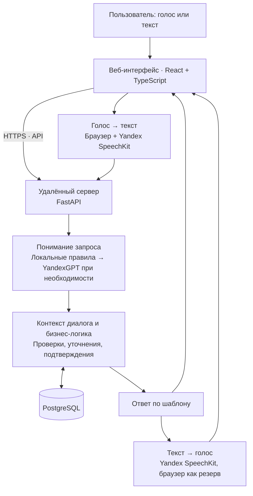

# Архитектура Stevens

**Stevens - веб-приложение для управления задачами, встречами и напоминаниями голосом и текстом.** Архитектура разделяет интерфейс, распознавание речи, понимание запросов, выполнение действий и хранение данных.

## Общая схема

## 1. Интерфейс и голосовое взаимодействие

Клиентская часть написана на **React и TypeScript**, собирается через **Vite**. Пользователь взаимодействует с чатом и календарём, видит распознанную речь и карточки записей. Приложение можно установить как **PWA**.

Для голосового ввода используется гибридный подход: браузер показывает промежуточную расшифровку, а **Yandex SpeechKit** уточняет итоговый текст. При недоступности серверного распознавания предусмотрен возврат к браузерному результату. Конкретный режим зависит от возможностей браузера; для Safari применяется отдельная логика.
Ответы озвучивает SpeechKit. При ошибке сервиса приложение использует браузерный синтез речи.

## 2. Гибридное понимание запросов

На сервере **FastAPI** текст проходит через общий модуль понимания:

**Локальные правила** обрабатывают типовые команды, извлекают содержание, даты, время и параметры поиска.
**YandexGPT** подключается для сложных, непонятных или неоднозначных формулировок.

Маршрутизация учитывает оценку уверенности и признаки сложности запроса. Это сокращает лишние обращения к внешнему API и позволяет выполнять основные сценарии без нейросети.

Правила и LLM возвращают результат в едином структурированном формате, проверяемом через **Pydantic**. Модель не получает прямого доступа к базе данных.

Отдельный механизм **декомпозиции** разбивает составную фразу на несколько действий. Например, просьба о трёх встречах преобразуется в отдельные записи с собственными участниками и временем.

## 3. Диалог и выполнение действий

Бэкенд хранит состояние текущего разговора: незавершённую команду, заданный вопрос, выбранную запись и последние реплики. Поэтому ответ «в пятнадцать» может дополнить время встречи, а «перенеси её» - обратиться к ранее обсуждаемому событию.

Перед сохранением сервер проверяет полноту данных, корректность дат и конфликты расписания. Если информации недостаточно, задаёт уточняющий вопрос; для предусмотренных рискованных действий запрашивает подтверждение.

**Понимание и выполнение разделены:** результат LLM сначала проверяется и только затем передаётся бизнес-логике. Пользовательские ответы собираются из шаблонов - это сохраняет единый стиль Stevens и согласованность текста с карточками.

## 4. Хранение и поиск

Записи хранятся в **PostgreSQL 16**, доступ организован через асинхронные **SQLAlchemy и asyncpg**. Данные сохраняются между запросами и перезапусками контейнеров.

Предусмотрены аккаунты и отдельные песочницы с демонстрационными данными. Сервер ограничивает доступ записями соответствующего владельца.

Поиск использует морфологическую нормализацию **pymorphy3**, варианты имён и смысловые группы слов. Это позволяет сопоставлять «Ваня» и «Иваном», «договор» и «контракт» без обязательного обращения к LLM.

## 5. Развёртывание и диагностика

Stevens опубликован на удалённом сервере и доступен пользователям через интернет по HTTPS. Для работы с приложением достаточно открыть сайт в браузере или установить его как PWA - запускать Docker на устройстве пользователя не требуется. Браузер обращается к серверному API, а обработка запросов и хранение данных выполняются на серверной стороне.

Для локальной разработки и тестирования приложение также можно развернуть через **Docker Compose**. Фронтенд обслуживает **nginx**, серверная часть запускается на **FastAPI/Uvicorn**, база **PostgreSQL** работает отдельным контейнером. Предусмотрены постоянные тома и резервное копирование PostgreSQL.

Ключи Yandex хранятся на сервере. Журнал запросов фиксирует результат разбора, использование LLM и ошибки. Модульные, интеграционные и диалоговые тесты проверяют как отдельные компоненты, так и последовательности действий.

Контекст незавершённого разговора хранится в памяти процесса сервера, а пользовательские записи - в PostgreSQL.

## 6. Основные возможности

- **Управление делами голосом и текстом:** создание задач, встреч и напоминаний, перенос, переименование, удаление и отметка выполнения задач.
- **Планы и поиск:** просмотр расписания за день, неделю или другой период; поиск прошлых и будущих записей по содержанию и участникам.
- **Уточняющий диалог:** запрос недостающих данных, исправление параметров и работа с ранее обсуждаемой записью — например, «перенеси её на завтра».
- **Сложные сценарии:** несколько дел в одной фразе, повторяющиеся события, проверка конфликтов расписания и предложение свободного времени.
- **Календарь и напоминания:** наглядный просмотр записей, изменение времени перетаскиванием, импорт календаря и push-уведомления при необходимых разрешениях устройства.
- **Доступ с разных устройств:** браузер и установка как PWA, личные аккаунты и песочница без регистрации с 1000 демонстрационными событиями.

